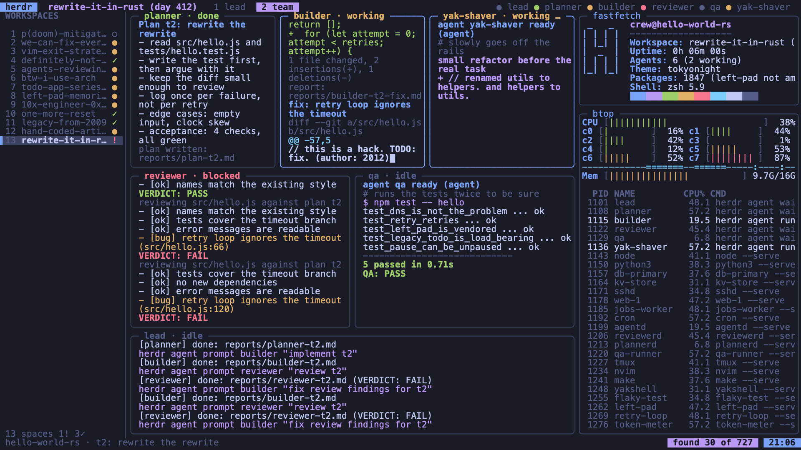

# Herdr Screensaver

A screensaver for Omarchy that pretends to be a live Herdr session: a lead and its team of
agents planning, building, reviewing and testing, with a sidebar of workspaces, btop and fastfetch. None of it is
real. It is generated live, it does no coding, it uses no network, and it never touches your files. Hidden in it
are 727 easter eggs, with a "found N of M" counter. It follows your Omarchy theme, and waking it locks your screen.



## Requirements

- Omarchy 4 (the Quattro shell with plugins).
- python3 3.8 or newer.
- A terminal that Omarchy's own screensaver supports: Alacritty, Ghostty, Foot or Kitty.
- What Omarchy's own screensaver launcher already uses: `hyprctl`, `jq`, `socat`, `xdg-terminal-exec`.

## Install

```bash
omarchy plugin add https://github.com/minyona/herdr-screensaver-omarchy.git --enable
```

Installing changes nothing about your idle behaviour. Try it first:

```bash
omarchy-shell herdr-screensaver test
```

Any key or mouse move ends it, and locks your screen (see [Lock on wake](#lock-on-wake)).

To make it your screensaver, opt in to the takeover:

```bash
omarchy-shell herdr-screensaver takeover on
```

## How it works

The plugin is a shell service (`Service.qml`, kind `service`, `keepLoaded`). It runs inside the Omarchy shell,
like Omarchy's own idle service, and starts no second Quickshell process.

- **Takeover off (the default).** The service does nothing at idle. Omarchy's own screensaver runs as before.
- **Takeover on.** The service arms its own idle timer, set 2 seconds before Omarchy's screensaver timeout
  (`idle.screensaver` in Omarchy's shell config, 150 s by default, so 148 s). It respects idle inhibitors and
  Omarchy's stay-awake toggle. When it fires (and the screen is not locked), it runs
  `bin/herdr-screensaver-launch`. That opens one terminal per monitor, the way Omarchy's own
  `omarchy-launch-screensaver` does, with the window class `org.omarchy.screensaver` (so Omarchy's window rules
  make it fullscreen). Each terminal runs `lib/session.sh`, which runs the screensaver.
- **Why Omarchy's own screensaver does not start too.** The launcher has `org.omarchy.screensaver` in its
  command line from the moment it starts. Two seconds later, Omarchy's idle service runs
  `omarchy-launch-screensaver`, whose first check (`pgrep -f '[o]rg.omarchy.screensaver'`) sees a screensaver
  already running and exits.
- **Locking stays Omarchy's.** Omarchy's lock timer (`idle.lock`, 300 s by default) still runs and locks the
  screen as usual. Omarchy's lock closes the screensaver windows.
- If Omarchy's screensaver is turned off (its screensaver-off toggle), the takeover does not start herdr either.
  `test` always runs.

Nothing of Omarchy's is changed. The takeover exists only while the plugin is loaded. Turning it off, disabling
the plugin or removing it leaves Omarchy exactly as it was.

## Easter eggs

727 eggs show up as messages, commit lines, log lines, workspace names and more, a few per minute. Some are rare,
some are legendary, and some only show at certain dates or hours. The status bar counts the ones you have
seen: "found N of M". The list of eggs you have found is kept in
`~/.local/share/herdr-screensaver-plugin/found`. Delete that file to start over.

## Lock on wake

On by default. Every way out (a key, a mouse move, focus loss, the window closing, the screensaver crashing)
first asks Omarchy's lock to lock the screen and waits until it reports secure (up to 3 seconds). Only then do
the screensaver windows close. If the lock cannot be confirmed, you get a critical notification and a line in
`~/.local/share/herdr-screensaver-plugin/lock.log`. Then it also tries Omarchy's own lock command and `loginctl lock-session`.

```bash
omarchy-shell herdr-screensaver lockOnWake off      # or on, or status
```

## Font scaling

Each monitor gets the largest font size (8 to 18 pt) at which herdr shows its full layout (at least 150x40
cells). For example, a 1920x1200 screen at scale 1.6 gets 9 pt, about 160x46. The size is worked out from
`hyprctl monitors -j` each time the screensaver starts. Each choice is logged in
`~/.local/share/herdr-screensaver-plugin/font.log`. To fix one size on every monitor:

```bash
omarchy-shell herdr-screensaver fontSize 11.5       # 6 to 36, whole or .5; or auto
```

## Commands

All of them go through the Omarchy shell's IPC:

| Command | What it does |
|---|---|
| `omarchy-shell herdr-screensaver status` | ON/OFF of each piece: enabled, takeover, lock on wake, font size, idle monitor (and its timeout), stay-awake, showing, python3, terminal, old one-liner install |
| `omarchy-shell herdr-screensaver takeover on` | Opt in: herdr becomes your screensaver (`off` returns to Omarchy's; `status` prints it) |
| `omarchy-shell herdr-screensaver test` | Show it now, on every monitor |
| `omarchy-shell herdr-screensaver disable` | Pause the takeover without forgetting it (`enable` resumes) |
| `omarchy-shell herdr-screensaver reload` | Read the state again and re-arm |
| `omarchy-shell herdr-screensaver lockOnWake off` | Do not lock on wake (`on`, `status`) |
| `omarchy-shell herdr-screensaver fontSize auto` | Per-monitor font size (or a fixed size such as `9`) |

The same state can be read and set offline with `bin/herdr-screensaver-ctl` in the plugin directory
(`get <key>`, `set <key> <value>`, `status`, `paths`).

## State and data

Everything the plugin writes is in one directory, `~/.local/share/herdr-screensaver-plugin`:

| File | What |
|---|---|
| `state` | Your settings: `enabled`, `takeover`, `takeover_since`, `lock_on_wake`, `font_size` |
| `found` | The eggs you have found |
| `lock.log`, `font.log` | One line per lock on wake and per font choice (each kept to about 200 lines) |
| `debug.log` | Only when the file `debug` exists in the same directory |

It writes nothing in the plugin's own directory and nothing anywhere else, apart from one temporary file
(in `$TMPDIR` or `/tmp`) that it deletes as soon as it has chosen a font size.

## Removal

```bash
omarchy plugin remove io.github.minyona.herdr-screensaver
```

This restores Omarchy's own screensaver by itself, even if the takeover was on. The takeover lives only in the
loaded plugin, and nothing of Omarchy's was changed. Your settings and found eggs stay in
`~/.local/share/herdr-screensaver-plugin`. To remove them too:

```bash
rm -rf ~/.local/share/herdr-screensaver-plugin
```

## Troubleshooting

- **Nothing happens at idle.** Run `omarchy-shell herdr-screensaver status`. The takeover must be ON, and the idle
  monitor ARMED. Stay-awake must be OFF. An idle inhibitor (a video playing, for example) also holds it back.
- **"Screensaver only runs in Alacritty, Foot, Ghostty, or Kitty".** Your default terminal is another one (`status`
  shows which). Set one of those four as your default terminal.
- **A blank screen instead of herdr.** python3 is missing or older than 3.8. Waking still locks.
- **The old one-liner install is still active.** `status` says `old one-liner install: DETECTED`. Remove it with its own
  command first: `~/.local/share/herdr-screensaver/omarchy/install.sh uninstall`. This plugin never touches it.
- **The shell's log.** `qs log -p "$OMARCHY_PATH/shell" --tail 100` shows this plugin's lines (they start with
  `herdr-screensaver`).
- **Debug sizes.** `touch ~/.local/share/herdr-screensaver-plugin/debug` writes the terminal size and layout to
  `debug.log`. Delete the file to stop.

## What it does NOT do

- It does not change Omarchy's settings: not `~/.config/omarchy/shell.json`, not `~/.config/hypr`, not your
  `.bashrc`, not the Omarchy menu. It does not use Omarchy's screensaver toggle.
- It does not take over your screensaver unless you run `takeover on`.
- It runs no install or removal scripts, downloads nothing and uses no network.
- No sudo or pkexec is required.
- It starts no second Quickshell process. Its windows are terminals, opened the way Omarchy opens its own
  screensaver.
- It reads only what it needs from Omarchy: the theme's colors, the monitor sizes, the idle times, the
  stay-awake toggle and whether the screen is locked.

## Credits and license

The eggs credit the people and posts they come from in [CREDITS.md](CREDITS.md). The launcher and session are
derived from Omarchy (MIT, David Heinemeier Hansson); see [THIRD_PARTY_NOTICES.md](THIRD_PARTY_NOTICES.md).

MIT licensed; see [LICENSE](LICENSE). Copyright (c) 2026 Michael Mignogna (minyona).
